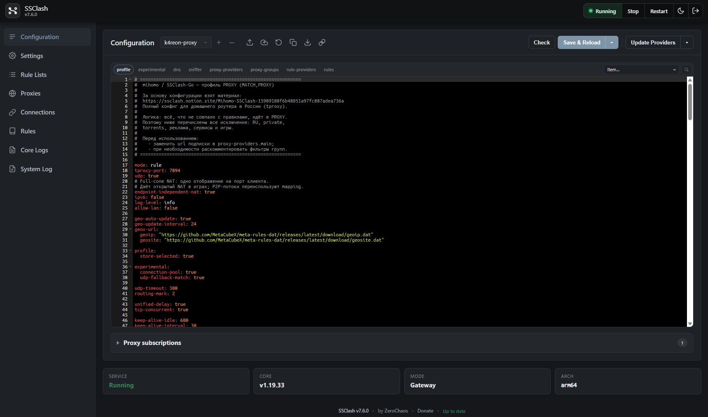

<p align="center">
  
</p>

# mihomo rules ru for ssclash

[](https://github.com/k4reon/mihomo-rules-ru/actions/workflows/build.yml)

Это рабочая база правил mihomo для домашних роутеров в России.
Конфигурация собрана и используется автором репозитория на своих
роутерах, а также публикуется для всех. В репозитории два профиля
и два полных конфига:

- `MATCH,PROXY` — всё неизвестное идёт в прокси;
- `MATCH,DIRECT` — всё неизвестное идёт напрямую, в прокси только сервисы.



<sub>SSClash-Go 7.6.0, профиль `k4reon-proxy`: конфиг целиком редактируется
и проверяется в веб-интерфейсе роутера.</sub>

## Идея

Один набор правил и два профиля, которые автор использует на своих
роутерах. Публичные источники сведены вместе, очищены от мусора и
дополнены тем, чего в них не хватает. Репозиторий — не коллекция
чужих конфигов, а рабочая база, проверенная на реальном роутере.

## Основа

За основу конфигурации взят материал:

https://ssclash.notion.site/Mihomo-SSClash-15989188f6b48051a97fc887adea736a

Полный текст перенесён в `docs/ssclash-notion.md` — включая разделы
про SSClash 4 и SSClash-Go. Изображения в документе ссылаются на
исходные файлы Notion.

## Состав базы

| Категория | Домены | CIDR | Куда идёт |
|---|---:|---:|---|
| private | 133 | 15 | DIRECT |
| ads | 131 | — | REJECT |
| ru | 1886 | — | DIRECT |
| ru-classical | 11 TLD | — | DIRECT |
| torrent | 491 | — | DIRECT |
| youtube | 179 | 2 | YouTube |
| games | 942 | 63 | Games |
| discord | 29 | 1 | Discord |
| ai | 217 | 2 | Ai |
| google | 1047 | 4 | DIRECT |
| messengers | 41 | 24 | Messengers |
| social | 609 | 23 | Fast |
| custom | 28 | — | PROXY / DIRECT |

Итого около 5733 доменов и 134 CIDR.

Полные объединённые списки по каждой категории лежат в `dist/lists/`
(`k4reon-<категория>-domains.txt` и `k4reon-<категория>-ip.txt`).
В репозитории также остаются `rules/<категория>/*.txt` — это только
локальные добавления поверх публичных источников; итоговый список
получается их слиянием при сборке.

## Структура

```
configs/     ssclash-go/ и ssclash-4/ — полные конфиги PROXY и DIRECT
dist/        готовые k4reon-*.mrs и classical-*.txt
dist/lists/  полные объединённые списки в читаемом .txt
rules/       локальные добавления по категориям + denylist
scripts/     merge.py — слияние и фильтрация; memory-limit.sh — память SSClash-Go
docs/        ssclash-notion.md — гайд, ssclash-remove.md — удаление SSClash
sources.json откуда брать публичные списки
build.ps1 / build.sh
```

Памятки: `docs/ssclash-notion.md` — настройка SSClash-Go/4, `docs/ssclash-remove.md` —
полное удаление SSClash-Go и SSClash legacy (OpenWrt).

`configs/ssclash-go/*.yaml` — полные конфиги в стиле SSClash-Go: tproxy,
DNS, sniffer, proxy-providers, группы `fallback`/`url-test`/`select`,
rule-providers и rules. Их можно брать целиком, а не собирать по частям.

## Источники

База собрана из публичных списков:

- [MetaCubeX/meta-rules-dat](https://github.com/MetaCubeX/meta-rules-dat/tree/meta)
  — `category-ru`, `whatsapp`, реклама, AI, соцсети;
- [DustinWin/ruleset_geodata](https://github.com/DustinWin/ruleset_geodata/releases/tag/mihomo-ruleset)
  — `games`, `private`, `trackerslist`, `telegramip`;
- [Keviin560/Shunt_Rules](https://github.com/Keviin560/Shunt_Rules)
  — Google, Steam, YouTube, Gemini, AI, Discord, Telegram, WhatsApp,
  соцсети и IP-списки;
- [hydraponique/roscomvpn-geosite](https://cdn.jsdelivr.net/gh/hydraponique/roscomvpn-geosite/release/mihomo/)
  и `roscomvpn-geoip` — torrent и private IP;
- `k4reon.com/ru-whitelist` — RU-домены, перенесены в `rules/ru/domains.txt`.

[jameszeroX/zkeen-ip](https://github.com/jameszeroX/zkeen-ip) проверен,
но не используется: `ru` — 13.5k CIDR, которые дублируют `GEOIP,RU`,
а CDN/хостинги (Amazon, Datacamp, OVH и т.д.) для домашнего роутера
слишком широкие. Discord-набор zkeen (`35.192.0.0/11`, `104.16.0.0/13`,
`162.158.0.0/15`) без UDP-портов заворачивает лишнее.

## Полные конфиги

- `configs/ssclash-go/PROXY.yaml` — полный `MATCH,PROXY` для SSClash-Go;
- `configs/ssclash-go/DIRECT.yaml` — полный `MATCH,DIRECT` для SSClash-Go;
- `configs/ssclash-4/PROXY.yaml` — полный `MATCH,PROXY` для SSClash 4;
- `configs/ssclash-4/DIRECT.yaml` — полный `MATCH,DIRECT` для SSClash 4.

Отличие SSClash 4 только в блоке контроллера и UI:

```yaml
external-controller: 0.0.0.0:9090
external-ui: ./ui
external-ui-url: "https://github.com/Zephyruso/zashboard/releases/latest/download/dist-cdn-fonts.zip"
```

В SSClash-Go остаётся `external-controller: 127.0.0.1:9090`, UI отдаёт
сам SSClash. В SSClash 4 API доступен по сети — доступ стоит ограничить
firewall или задать `secret`.

Перед использованием заменить:

- `url` подписки в `proxy-providers.main`;
- при необходимости — фильтры групп (в примерах они закомментированы).

### Почему такие настройки

**`tproxy-port` + `udp: true`**
Роутер работает в режиме шлюза, трафик заворачивается через tproxy.
UDP включён отдельно — без него не работают игры, Discord и часть AI.

**`endpoint-independent-nat: true`**
Full-cone NAT: на порт клиента создаётся одно NAT-отображение.
Это даёт открытый NAT в играх. Побочный эффект: P2P-потоки игры
(например, CoD) не видны в `/connections` отдельными строками — они
переиспользуют одно отображение.

**DNS**
- обычные запросы — DoH через группу `PROXY`;
- `.lan`, `.local`, `kion.ru`, `wink.ru` — системный DNS;
- `geosite:category-ru` — российские DNS (Yandex), чтобы RU-сервисы
  не зависели от прокси;
- `rule-set:k4reon-ai-domains` — DNS для AI через группу `Ai`;
- `respect-rules: false` — DNS не зависит от правил маршрутизации.

**Sniffer**
`force-dns-mapping` и `parse-pure-ip` нужны, чтобы доменные правила
срабатывали, когда приложение подключается по IP. Без этого часть
трафика уходила бы в `MATCH`.

**Группы**
`PROXY` — общий выход, `Fast` — ручной выбор узла. `YouTube`, `Ai`,
`Discord`, `Games`, `Messengers` — тематические группы. `Games`
по умолчанию `DIRECT`: для части игр прямой маршрут лучше, при
необходимости узел выбирается вручную.

### Параметры конфигурации

Короткий справочник по каждому блоку. В самих конфигах те же пояснения
стоят комментариями рядом с параметрами.

**Общие**

| Параметр | Что это | Почему так |
|---|---|---|
| `mode: rule` | режим маршрутизации по правилам | `global`/`direct` не используются: нужна гибкая схема |
| `tproxy-port: 7894` | порт прозрачного прокси | роутер работает шлюзом, трафик LAN заворачивается в tproxy |
| `udp: true` | проксировать UDP | без UDP не работают игры, Discord, голосовые звонки, часть AI |
| `endpoint-independent-nat: true` | full-cone NAT | открытый NAT в играх; P2P-потоки переиспользуют одно отображение |
| `ipv6: false` | отключить IPv6 | у части провайдеров он ломает маршрутизацию и даёт утечки мимо прокси |
| `log-level: info` | уровень логов | `info` достаточно; `debug` — для отладки, даёт много логов |
| `allow-lan: false` | не слушать прокси/API на всех интерфейсах | доступ только с самого роутера, наружу ничего не открыто |
| `geo-auto-update` + `geo-update-interval: 24` | автообновление geoip/geosite | базы MetaCubeX меняются, раз в сутки хватает |
| `geox-url` | откуда качать базы | официальные релизы `MetaCubeX/meta-rules-dat` |
| `profile.store-selected: true` | запоминать выбранные узлы | после перезапуска группы остаются на том же узле |
| `experimental.connection-pool: true` | пул соединений | меньше задержка и нагрузка на роутер |
| `experimental.udp-fallback-match: true` | UDP без совпадения по правилам | уходит в `MATCH`, а не теряется |
| `udp-timeout: 300` | тайм-аут UDP-сессии | 5 минут простоя — баланс между памятью и переподключениями |
| `routing-mark: 2` | fwmark | помечает трафик самого mihomo, чтобы он не заворачивался в tproxy повторно |
| `unified-delay: true` | единая методика замера задержки | цифры в интерфейсе сравнимы между узлами |
| `tcp-concurrent: true` | параллельные TCP-попытки | соединение устанавливается быстрее |
| `keep-alive-*` | параметры keep-alive | реже переподключения, но без вечно висящих сессий |
| `external-controller` | API mihomo | в SSClash-Go — `127.0.0.1:9090`; в SSClash 4 — `0.0.0.0:9090` + UI, доступ стоит ограничить firewall или `secret` |

**DNS**

| Параметр | Что это | Почему так |
|---|---|---|
| `listen: 127.0.0.1:7874` | локальный DNS-сервер | слушаем только localhost, запросы заворачивает tproxy |
| `ipv6: false` | без AAAA | IPv6 выключен, лишние запросы не нужны |
| `cache-algorithm: arc` | алгоритм кэша | ARC эффективнее LRU при типичном домашнем трафике |
| `respect-rules: false` | DNS не подчиняется правилам | иначе получится рекурсия: резолв зависит от маршрута, а маршрут — от резолва |
| `default-nameserver` | бутстрап | резолвит адреса самих DoH-серверов |
| `proxy-server-nameserver` | резолв адресов прокси | нужен до поднятия прокси, поэтому отдельный список |
| `nameserver` (`#Fast`) | обычные запросы | DoH через группу `Fast`, чтобы не зависеть от DNS провайдера |
| `nameserver-policy` | исключения | `+.lan`/`+.local` — системный DNS; `kion.ru`/`wink.ru` — системный; `category-ru` — DNS Яндекса; AI — DoH через `Ai` |

**Sniffer**

| Параметр | Что это | Почему так |
|---|---|---|
| `enable: true` | определять домен из трафика | иначе соединения «по IP» не попадут в доменные правила |
| `force-dns-mapping` | подставлять домен из DNS | приложение подключается по IP, а правило — доменное |
| `parse-pure-ip` | сниффить соединения без домена | закрывает случаи, когда DNS прошёл мимо mihomo |
| `override-destination: false` | не подменять адрес | только определяем домен, маршрут не меняем |
| `sniff.HTTP/TLS.ports` | какие порты сниффить | 80/8080-8880 и 443/8443 покрывают почти весь веб |
| `skip-domain` | не сниффить | Apple/iCloud ломаются при подмене домена; `.lan`/`.local` — локальные |

**Провайдеры и группы**

| Параметр | Что это | Почему так |
|---|---|---|
| `anchors` | шаблоны rule-providers | одна строка на тип вместо 24 повторов |
| `interval: 43200` | обновление наборов | раз в 12 часов: списки меняются нечасто |
| `proxy: PROXY` | чем качать наборы | `fallback` `Fast`→`DIRECT`: работает и при блокировке GitHub, и без прокси |
| `proxy-providers.proxy: DIRECT` | чем качать подписку | подписка нужна до поднятия прокси, зависимость недопустима |
| `proxy-providers.interval: 3600` | обновление подписки | раз в час: узлы меняются чаще списков |
| `health-check` | проверка узлов | `generate_204`, 10 минут, `lazy` — проверяем только используемые |
| `PROXY` (fallback) | общий выход | первый живой из `Fast`/`DIRECT` |
| `Fast` (url-test) | выбор узла | автоматически лучший по задержке |
| `YouTube`, `Ai`, `Discord`, `Messengers` (fallback) | сервисные группы | у каждого сервиса свой набор подходящих стран |
| `Games` (select, `DIRECT`) | игры | по умолчанию напрямую: для игр прямой маршрут обычно лучше |
| `GLOBAL` (hidden) | переключение всего трафика | нужен для отладки, в обычной работе не используется |

**Правила**

| Приём | Что это | Почему так |
|---|---|---|
| `no-resolve` у IP-правил | не резолвить домен ради IP-правила | быстрее и меньше DNS-запросов |
| `AND,((NETWORK,UDP),(RULE-SET,k4reon-games-ip))` | IP-набор игр только для UDP | в публичном `Game_IP` есть облачные диапазоны; без фильтра туда уйдёт лишний TCP |
| порядок `ads → custom-proxy → ru` | приоритет правил | `.ru` из `ru-classical` перебил бы блокировку рекламы и прокси-исключения |
| `SRC-IP-CIDR` / `IP-CIDR` для LAN | исключение устройства из проксирования | примеры закомментированы в каждом конфиге |

Исключение устройства: раскомментировать в блоке `rules` две строки и указать IP.
`SRC-IP-CIDR` — трафик **от** устройства, `IP-CIDR` — трафик **к** устройству.
Строки стоят после блока рекламы, поэтому реклама для устройства продолжает
блокироваться, а весь остальной трафик идёт напрямую.

### Порядок правил

1. `private` → DIRECT
2. `ads` → REJECT
3. `custom-proxy` → PROXY (выше RU, иначе `.ru` из `ru-classical` перебьёт)
4. `ru` → DIRECT
5. `torrent` → DIRECT
6. `youtube` → YouTube
7. `games` → Games
8. `discord` → Discord
9. `ai` → Ai
10. `google` → DIRECT
11. `messengers` → Messengers
12. `social` → Fast
13. `custom-direct` → DIRECT
14. `GEOIP,RU/SU` → DIRECT (только в PROXY)
15. `MATCH` → PROXY или DIRECT

Ключевые решения:

- **Реклама и custom-proxy выше RU.** `category-ru` содержит TLD `.ru`,
  поэтому `adriver.ru` и другие `.ru`-рекламники нужно блокировать до RU-правил,
  а `.ru`-домены из `custom-proxy` — иначе они уйдут в DIRECT по `DOMAIN-SUFFIX,ru`.
- **AI и YouTube выше Google.** Иначе `google.com` перехватит
  `gemini.google.com` и `youtube.com` и отправит их в DIRECT.
- **Google намеренно DIRECT** — поиск должен видеть российский IP.
  Нейросети при этом идут в `Ai`.
- **`games-ip` только для UDP:**
  `AND,((NETWORK,UDP),(RULE-SET,k4reon-games-ip)),Games`.
  В публичном `Game_IP` есть `35.192.0.0/12` (Google Cloud); без
  UDP-фильтра туда уйдёт лишний TCP.

### mrs и classical

`mrs` поддерживает только `behavior: domain` и `behavior: ipcidr`.
Порты и `AND` лежат в `*-ports.txt` / `*-classical.txt`
(`behavior: classical`, `format: text`).

Домены в базе собираются как **суффиксные** (`+.domain`), а не точные.
Иначе `www.google.com` не совпал бы с `google.com` и ушёл бы в `MATCH`.

## Как использовать

**Вариант 1 — полный конфиг.**
Для SSClash-Go: `configs/ssclash-go/PROXY.yaml` или `DIRECT.yaml`.
Для SSClash 4: `configs/ssclash-4/PROXY.yaml` или `DIRECT.yaml`.
Заменить подписку и скопировать на роутер как `config.yaml`
(или в профиль SSClash).

**Вариант 2 — только правила.**
Перенести блоки `rule-providers` и `rules` из выбранного полного
конфига в существующий конфиг.

Если в конфиге уже есть anchors, строки можно сократить:

```yaml
k4reon-games-domains: { <<: *domain, url: ... }
k4reon-games-ip: { <<: *ipcidr, url: ... }
k4reon-games-ports: { <<: *classical, url: ... }
```

### Что можно удалить из старого конфига

Эти провайдеры заменены базой:

```
games@domain
games@ip
steam@domain
discord@domain
ru-whitelist
category-ru@domain
```

Остальные провайдеры (`google`, `youtube`, `telegram`, `ai`, `private`,
`torrent` и т.д.) тоже можно убрать, если они полностью покрыты
`k4reon-*` и имена групп совпадают.

## Обновление

Списки обновляются сами, но не мгновенно — в два шага:

1. **Источники → дистрибутив.** GitHub Actions запускает сборку при
   каждом пуше в `main` и раз в неделю по расписанию (воскресенье,
   03:00 UTC): перекачивает публичные списки, пересобирает
   `dist/*.mrs` и `dist/lists/*.txt` и коммитит изменения, если они есть.
2. **Дистрибутив → роутер.** mihomo обновляет `rule-providers`
   каждые 12 часов (`interval: 43200`), подписку — каждый час
   (`interval: 3600`). Отдельно ничего настраивать не нужно.

Скачивание правил идёт через группу `PROXY`:

```yaml
a1: &domain { type: http, format: mrs, behavior: domain, interval: 43200, proxy: PROXY }
```

`proxy: PROXY` — это `fallback` из `Fast` и `DIRECT`. Поэтому:

- если провайдер режет `raw.githubusercontent.com`, файлы всё равно
  скачаются через прокси-узел;
- если прокси недоступен, используется прямой маршрут;
- если не скачалось ни то ни другое, mihomo оставляет **последнюю
  успешную копию** — правила продолжают работать, просто не обновляются.

Без прокси (или при полностью закрытом GitHub) можно переключить `url`
провайдеров на зеркало, например jsDelivr:

```yaml
url: https://cdn.jsdelivr.net/gh/k4reon/mihomo-rules-ru@main/dist/k4reon-games-domains.mrs
```

Зеркала кэшируют файлы дольше (до 12 часов), поэтому правки появляются
там с задержкой.

Вручную: кнопка **Update Providers** в веб-интерфейсе SSClash или
`PUT /providers/rules/<имя>` через API mihomo.

Нюансы:

- `raw.githubusercontent.com` отдаётся через CDN с кэшем около 5 минут,
  поэтому свежий коммит появляется у клиента не сразу;
- если правил нет в кэше клиента, первая загрузка идёт при старте;
- расписание GitHub может отключить после 60 дней без активности
  в репозитории. Тогда придёт уведомление, а включить обратно можно
  кнопкой **Enable workflow** в разделе Actions; запустить сборку
  вручную — **Run workflow**. Любой твой коммит сбрасывает этот счётчик.

## Сборка

```powershell
.\build.ps1
```

или:

```bash
./build.sh
```

Скрипт скачивает mihomo, конвертирует mrs-источники в текст, запускает
`scripts/merge.py`, собирает `dist/*.mrs`, копирует classical-файлы
и публикует полные списки в `dist/lists/`.
GitHub Actions пересобирает `dist/` на каждый пуш и раз в неделю по расписанию.

## Добавление правил

- домен — `rules/<категория>/domains.txt`;
- CIDR — `rules/<категория>/ipcidr.txt`;
- порт/AND — `rules/<категория>/ports.txt` или `classical.txt`;
- новый источник — `sources.json` (`format`: `plain`, `loon`, `v2fly`, `mrs`);
- мусор — `rules/denylist.txt`.

После изменений: `./build.ps1`, затем коммит `dist/`.

## Исключение устройств

Иногда нужно, чтобы конкретное устройство в домашней сети не шло через прокси.
Способов два, и результат у них разный.

### 1. Без прокси, но под mihomo

В блоке `rules` каждого конфига есть готовые закомментированные строки:

```yaml
#- SRC-IP-CIDR,IP устройства/32,DIRECT # от устройства
#- IP-CIDR,IP устройства/32,DIRECT # к устройству
```

- `SRC-IP-CIDR` — трафик **от** устройства идёт в `DIRECT`;
- `IP-CIDR` — трафик **к** устройству (например, к локальному сервису).

Раскомментировать и указать свои IP. Строки стоят после блока рекламы:
устройство перестаёт проксироваться, но блокировка рекламы для него
продолжает работать. DNS, сниффинг и остальная логика mihomo тоже остаются.

### 2. Полный обход mihomo (SSClash-Go)

Если устройство должно выходить в интернет вообще без участия mihomo —
не только без прокси, но и без tproxy и DNS-перехвата — используется
настройка SSClash-Go `BYPASS_SOURCES`:

```
BYPASS_SOURCES=IP устройства/32
```

Задаётся в веб-интерфейсе SSClash (настройки перехвата) или в файле
`/opt/clash/.ssclash/settings`. Список — CIDR через запятую.
После изменения нужен перезапуск сервиса: он кратко прерывает соединения.

Это настройка роутера, в конфигах mihomo её нет — при переносе конфига
на другой роутер её нужно задать отдельно.

В **SSClash 4** (LuCI-приложение) клиентского bypass нет: настройки
`BYPASS_SOURCES` там не существует. Для SSClash 4 остаются правила
`SRC-IP-CIDR` из первого способа (без прокси, но под mihomo), исключение
отдельного интерфейса/VLAN или ручное правило в firewall.

### Что выбрать

| Задача | Способ |
|---|---|
| Не проксировать устройство, но оставить блокировку рекламы и DNS mihomo | правила в конфиге |
| Полностью исключить устройство из перехвата mihomo | `BYPASS_SOURCES` (только SSClash-Go) |

## Проверка

Конфиги проверены на роутере:

```
configs/ssclash-go/PROXY.yaml   → test is successful
configs/ssclash-go/DIRECT.yaml  → test is successful
configs/ssclash-4/PROXY.yaml    → test is successful
configs/ssclash-4/DIRECT.yaml   → test is successful
```

## Память на слабых роутерах

Mihomo написан на Go. На роутерах с небольшим объёмом ОЗУ (128–256 МБ)
он со временем может занимать всё больше памяти: появляются просадки
скорости, подвисает веб-интерфейс, в тяжёлых случаях роутер перезагружается
из-за нехватки памяти.

Скрипт ниже ограничивает память Go-рантайма двумя переменными:

| Переменная | Что делает | По умолчанию |
|---|---|---|
| `GOGC` | как часто запускать сборщик мусора; меньше — чаще, памяти меньше | 100 |
| `GOMEMLIMIT` | мягкий лимит памяти: при приближении сборщик работает активнее | нет |

`GOMEMLIMIT` — **не жёсткий лимит**: он не гарантирует, что процесс
не превысит значение, а лишь подсказывает рантайму, когда убираться.

### Нужно ли это вам

Подключитесь к роутеру по SSH и посмотрите объём ОЗУ:

```sh
free -m
```

В строке `Mem` возьмите значение в столбце `total`.

| ОЗУ | Нужно? |
|---|---|
| 128 МБ | да |
| 256 МБ | рекомендуется |
| 512 МБ и больше | обычно нет, памяти хватает |

### Как применить

Все команды выполняются **на роутере по SSH от root**.

Одна команда — скачает скрипт и сразу запустит его:

```sh
wget -O /tmp/memory-limit.sh https://raw.githubusercontent.com/k4reon/mihomo-rules-ru/main/scripts/memory-limit.sh && sh /tmp/memory-limit.sh
```

Дальше скрипт сам всё спросит:

```
========================================
 SSClash-Go: настройка памяти
========================================
 ОЗУ роутера:  986 MiB
 Рекомендуется: GOGC=75, GOMEMLIMIT=246MiB

Что сделать?
  1) Применить рекомендуемые значения
  2) Указать свои значения
  3) Откатить (убрать настройку)
  0) Выйти
Выбор [1]:
```

Enter — применить рекомендованное. Скрипт сделает бэкап, перезапустит
SSClash и покажет итоговые переменные и текущий RSS.

### Без вопросов

```sh
sh /tmp/memory-limit.sh --yes        # применить рекомендуемые
sh /tmp/memory-limit.sh 50 96MiB     # свои значения
sh /tmp/memory-limit.sh --dry-run    # показать diff, ничего не менять
sh /tmp/memory-limit.sh --restore    # откатить
```

Ориентиры для своих значений:

| RAM | GOGC | GOMEMLIMIT |
|---|---:|---|
| 128 МБ | 50 | 64–80 MiB |
| 256 МБ | 50–75 | 96–128 MiB |
| 512 МБ | 75 | 160–192 MiB |
| 1 ГБ | 75–100 | 192–256 MiB |

Не ставьте лимит меньше 64 MiB: сборщик мусора будет работать почти
постоянно, вырастет нагрузка на CPU и появятся просадки скорости.

### Важно

- `scripts/memory-limit.sh` — путь **внутри репозитория**. На роутере скрипт
  лежит там, куда вы его скачали, поэтому запуск — `sh memory-limit.sh`
  (или `sh /tmp/memory-limit.sh`), а не `scripts/memory-limit.sh`;
- обновление SSClash-Go заменяет `/etc/init.d/ssclash` — после обновления
  настройку нужно применить заново (скрипт можно запускать повторно);
- перезапуск службы кратко прерывает соединения;
- идея и базовая реализация — [F5GO-Mihomo-stuff](https://github.com/F5GO/F5GO-Mihomo-stuff) (MIT).

## Дисклеймер

Правила рассчитаны на типовой домашний роутер в России. Провайдеры,
регионы и блокировки меняются — конфигурацию стоит проверять на своём
подключении. Секретов и персональных данных в репозитории нет.
